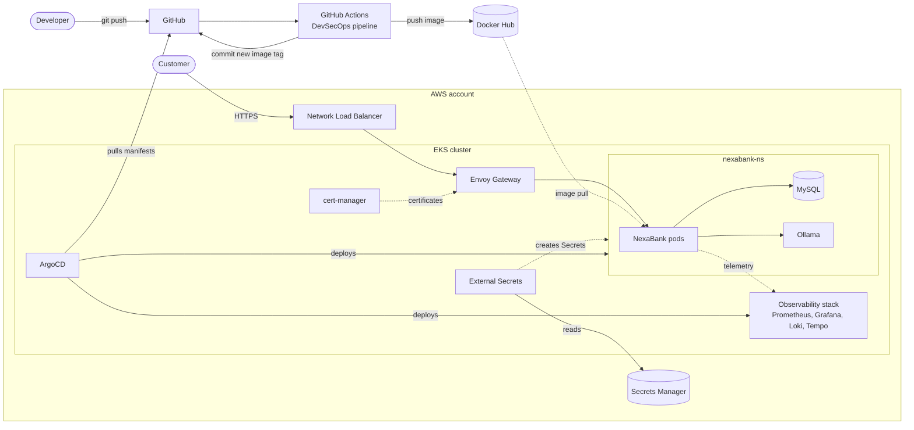
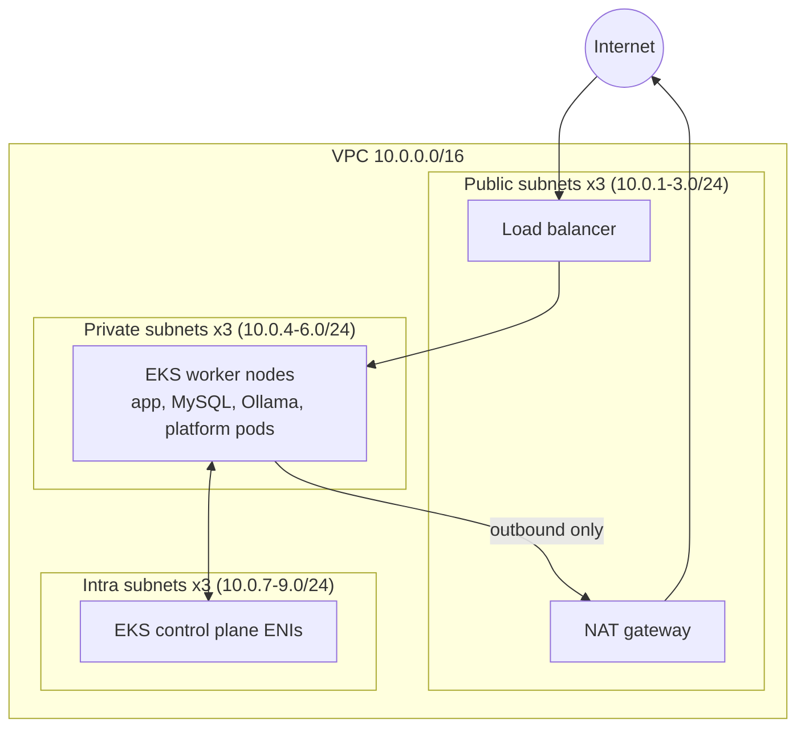
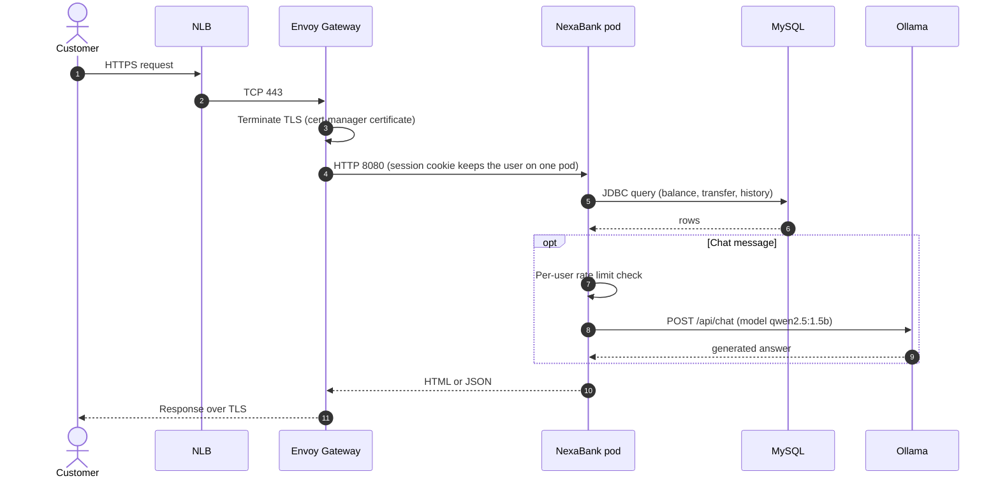
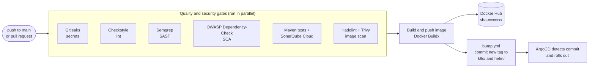
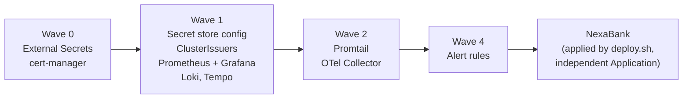
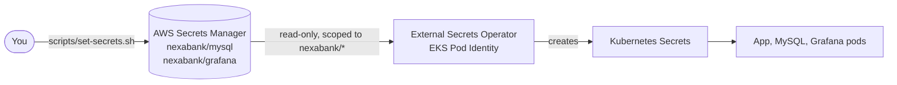
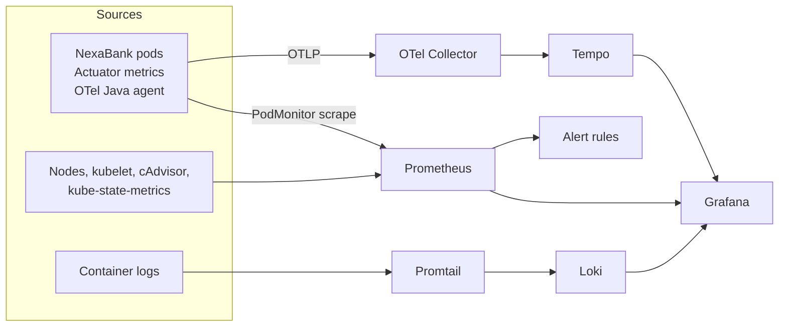
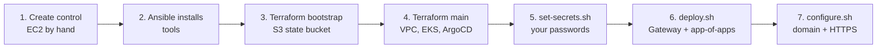

<div align="center">

# NexaBank

**A cloud-native banking platform with an on-cluster AI assistant, shipped through a DevSecOps pipeline and run on AWS EKS with Terraform and GitOps.**

[](https://www.oracle.com/java/technologies/javase/jdk21-archive-downloads.html)
[](https://spring.io/projects/spring-boot)
[](terraform/)
[](terraform/)
[](gitops/)
[](.github/workflows/devsecops.yml)

</div>

---

## Contents

1. [Overview](#overview)
2. [Project tiers](#project-tiers)
3. [Architecture](#architecture)
4. [How a request flows](#how-a-request-flows)
5. [CI/CD pipeline](#cicd-pipeline)
6. [GitOps and deployment order](#gitops-and-deployment-order)
7. [Secrets](#secrets)
8. [Observability](#observability)
9. [Security](#security)
10. [Scaling and reliability](#scaling-and-reliability)
11. [Technology stack](#technology-stack)
12. [Run it locally](#run-it-locally)
13. [Deploy to AWS](#deploy-to-aws)
14. [Configuration reference](#configuration-reference)
15. [Repository layout](#repository-layout)
16. [Design decisions](#design-decisions)
17. [Known limits](#known-limits)

---

## Overview

NexaBank is a web banking application: customers register, log in, deposit, withdraw and transfer money, review their transactions, and ask questions in an AI chat assistant. The assistant is a small language model (Ollama, `qwen2.5:1.5b`) that runs inside the same cluster, so no data leaves the platform.

The repository holds everything needed to go from a `git push` to a running, observable, HTTPS-protected deployment on AWS:

| You push | What happens automatically |
| --- | --- |
| Application code | Secret scan, lint, SAST, dependency scan, tests, image scan, image build and push, manifest bump, rollout to EKS |
| Kubernetes manifests or Helm values | ArgoCD syncs the change to the cluster |
| Terraform | CI checks formatting and validity; you apply it from the control machine |

## Project tiers

The platform is built in layers. Each tier has one job and talks only to its neighbours.

| Tier | Responsibility | Components | Where it lives |
| --- | --- | --- | --- |
| **1. Edge** | Public entry, TLS, routing | AWS Network Load Balancer, Envoy Gateway (Gateway API), cert-manager + Let's Encrypt | `k8s/gateway-*`, `gitops/gateway`, `gitops/cert-manager` |
| **2. Application** | Business logic, UI, sessions, chat endpoint | Spring Boot 3.5 on Java 21 (virtual threads), Thymeleaf pages, Spring Security | `backend/`, `k8s/app` |
| **3. Data** | Accounts and transactions | MySQL 8 StatefulSet on an encrypted gp3 volume, Flyway migrations | `k8s/app` |
| **4. AI** | Chat assistant | Ollama serving `qwen2.5:1.5b` from a persistent model volume | `k8s/app` |
| **5. Platform services** | Things every workload needs | External Secrets Operator, cert-manager, metrics-server, EBS CSI driver | `gitops/argocd/platform`, `terraform/` |
| **6. Observability** | See what is happening | Prometheus, Grafana, Loki, Promtail, Tempo, OpenTelemetry Collector, alert rules | `gitops/observability` |
| **7. Infrastructure** | The cloud itself | VPC, EKS, IAM Pod Identity roles, Secrets Manager, S3 state bucket | `terraform/` |
| **8. Delivery** | Build, scan, deploy | GitHub Actions, Docker Hub, ArgoCD, Ansible control machine | `.github/workflows`, `gitops/argocd`, `ansible/`, `scripts/` |

## Architecture

### System overview



### Network layout

One VPC, three availability zones, three subnet tiers.



- Worker nodes have no public IPs. Inbound traffic reaches them only through the load balancer; outbound traffic (image pulls, Let's Encrypt, Docker Hub) leaves through one NAT gateway.
- The control plane network interfaces sit in isolated subnets that have no route to the internet.

## How a request flows



HTTP on port 80 is redirected to HTTPS by an `HTTPRoute` filter. Every request also produces a metric, a log line carrying a `trace_id`, and a trace span (see [Observability](#observability)).

## CI/CD pipeline



| Stage | Workflow | Tool | Catches |
| --- | --- | --- | --- |
| Secret scan | `secrets_scan.yml` | Gitleaks | Credentials committed to Git |
| Lint | `lint.yml` | Checkstyle | Style violations |
| SAST | `sast.yml` | Semgrep | Insecure code patterns |
| SCA | `sca.yml` | OWASP Dependency-Check | Known CVEs in Maven dependencies |
| Test and quality | `sonar_scan.yml` | Maven, SonarQube Cloud | Failing tests, code smells |
| Image scan | `image_scan.yml` | Hadolint, Trivy | Dockerfile problems, OS and library CVEs |
| Push | `docker_push.yml` | Docker Buildx | Builds `<user>/nexabank:sha-<7>` |
| Bump | `bump.yml` | sed, git | Writes the tag into the deploy files, commits with `[skip ci]` |

Also in `.github/`: `terraform-ci.yml` (fmt, validate, tflint) and Dependabot for Actions, Maven, Docker and Terraform. Actions are pinned to commit SHAs. The pipeline runs only when `backend/**` or the workflows change, so the bump commit does not trigger another build.

## GitOps and deployment order

ArgoCD uses the **app-of-apps** pattern: one root Application (`gitops/argocd/platform.yml`) creates a child Application per component. Sync waves control the order, so CRDs exist before the resources that use them.



Bootstrapping:

1. **Terraform** builds the VPC and EKS cluster and installs ArgoCD.
2. **`scripts/deploy.sh`** installs Envoy Gateway, creates the Gateway class and the secret store, and applies the root Application.
3. **ArgoCD** installs everything else from Git. Changing anything afterwards is a `git push`.

The application can be deployed from plain manifests (`k8s/`, default) or the Helm chart (`helm/nexabank`). Both create the same resources; apply only one.

## Secrets

No password is stored in Git, Terraform state or container images.



Terraform creates the empty secret containers and the IAM role; you supply the values. The External Secrets role can read only secrets whose name starts with `nexabank/`.

## Observability



| Signal | Stack | Retention |
| --- | --- | --- |
| Metrics | Prometheus, node-exporter, kube-state-metrics, cAdvisor, app `PodMonitor` | 7 days / 8 GB |
| Logs | Promtail to Loki (single binary, gp3 volume) | 7 days |
| Traces | OpenTelemetry Java agent to the OTel Collector to Tempo; health-check spans are filtered out | local storage |
| Dashboards | Grafana with Prometheus, Loki and Tempo data sources | |
| Alerts | `NexaBankNoReplicasAvailable`, `NexaBankHigh5xxRate`, `NexaBankPodsCannotStart`, `OllamaDown`, `StoragePending` | |

Logs carry the trace ID, so you can jump from a log line to its trace in Grafana. Nothing is exposed publicly; open Grafana with a port-forward:

```bash
kubectl -n observability port-forward svc/grafana 3000:80    # http://localhost:3000, user admin
```

## Security

| Layer | Control |
| --- | --- |
| Source | Gitleaks on every push; Dependabot for dependencies and actions; Actions pinned to SHAs |
| Build | Semgrep (SAST), OWASP Dependency-Check (SCA), Hadolint, Trivy; multi-stage Dockerfile |
| Image | Immutable `sha-<7>` tags, never `latest` for the app |
| Network | Private worker nodes; load balancer is the only public entry; control plane in isolated subnets |
| Transport | TLS terminated at the Gateway with Let's Encrypt certificates; HTTP redirects to HTTPS |
| Runtime | Pods run as non-root with `allowPrivilegeEscalation: false`, all Linux capabilities dropped, seccomp default profile |
| Identity | EKS Pod Identity gives each controller its own narrowly scoped IAM role; no node-wide credentials |
| Secrets | Secrets Manager + External Secrets; encrypted EBS volumes; secrets never in Git or state |
| Application | Spring Security authentication; per-user rate limit on the AI chat |

## Scaling and reliability

- **App tier:** a HorizontalPodAutoscaler keeps 2 to 4 replicas, scaling on 70 % CPU (fast scale-up, slow scale-down). Startup, readiness and liveness probes use Actuator health endpoints. Cookie-based session affinity at the Gateway keeps a user on one pod.
- **Data tier:** one MySQL replica on a gp3 volume that survives pod restarts. Schema changes are versioned with Flyway.
- **AI tier:** one Ollama replica; the model lives on a persistent volume so it downloads only once.
- **Cluster:** managed node group across three availability zones, 3 nodes by default and up to 5; metrics-server for autoscaling.
- **Startup order:** an init container makes the app wait for MySQL.

## Technology stack

| Area | Technology |
| --- | --- |
| Backend | Java 21, Spring Boot 3.5, Spring Security, Spring Data JPA, Flyway |
| Frontend | Server-rendered Thymeleaf pages |
| Database | MySQL 8 |
| AI | Ollama, `qwen2.5:1.5b` |
| Containers | Docker (multi-stage), Docker Hub |
| Orchestration | Amazon EKS (Kubernetes 1.36), Envoy Gateway (Gateway API), HPA |
| Infrastructure as code | Terraform (S3 remote state with native locking), Ansible |
| GitOps | ArgoCD (app-of-apps, sync waves), Helm |
| CI/CD | GitHub Actions: Gitleaks, Checkstyle, Semgrep, OWASP Dependency-Check, SonarQube Cloud, Hadolint, Trivy |
| Secrets | AWS Secrets Manager, External Secrets Operator, EKS Pod Identity |
| TLS | cert-manager, Let's Encrypt (HTTP-01) |
| Observability | Prometheus, Grafana, Loki, Promtail, Tempo, OpenTelemetry |

## Run it locally

Requirements: Docker with Compose.

```bash
cp .env.example .env          # change the passwords
docker compose up --build
```

Open <http://localhost:8080>. Compose starts MySQL, Ollama (the model, about 1 GB, downloads on first start) and the app. The manifests in `k8s/` also run on a local `kind` cluster.

## Deploy to AWS

The full step-by-step runbook is **[DEPLOY.md](DEPLOY.md)**. The path is:



| Script | Purpose |
| --- | --- |
| `scripts/configure.sh` | Sets repo URL, region, domain and Let's Encrypt email across the repo |
| `scripts/set-secrets.sh` | Stores your database and Grafana passwords in Secrets Manager |
| `scripts/deploy.sh` | Installs Envoy Gateway and the ArgoCD app-of-apps; safe to re-run |
| `scripts/destroy.sh` | Tears everything down in a safe order; `--bootstrap` also removes the state bucket |

Cost note: EKS, the worker nodes, the NAT gateway and the load balancer bill by the hour. Destroy the environment when you are not using it.

## Configuration reference

**GitHub Actions** (Settings, Secrets and variables, Actions):

| Name | Type | Used for |
| --- | --- | --- |
| `DOCKERHUB_USERNAME` | variable | Image repository owner |
| `DOCKERHUB_TOKEN` | secret | Docker Hub login |
| `SONAR_TOKEN` | secret | SonarQube Cloud |
| `SONAR_HOST_URL` | variable | SonarQube host |
| `NVD_API_KEY` | secret | OWASP Dependency-Check (free key from nvd.nist.gov) |

**Terraform** (`terraform/terraform.tfvars`): `aws_region`, `cluster_name`, `cluster_version`, `node_instance_type`, `node_desired_count`, `node_max_count`, `node_disk_size`. The region is set here once and every script reads it from here.

**Application** (environment, from the ConfigMap and the Secret): `MYSQL_HOST`, `MYSQL_PORT`, `MYSQL_DATABASE`, `OLLAMA_URL`, `OLLAMA_MODEL`, plus the credentials from Secrets Manager.

## Repository layout

```
.
├── backend/                Spring Boot app, Dockerfile, OpenTelemetry Java agent
├── k8s/
│   ├── app/                application, MySQL, Ollama, HPA, PVCs, services, PodMonitor
│   ├── gateway-http/       Gateway + routes without TLS
│   └── gateway-https/      Gateway + routes with TLS and HTTP-to-HTTPS redirect
├── helm/nexabank/          the same application as a Helm chart
├── gitops/
│   ├── argocd/             root Application, app Applications, platform/ (one per component)
│   ├── gateway/            GatewayClass for Envoy Gateway
│   ├── cert-manager/       Let's Encrypt ClusterIssuers (staging and production)
│   ├── external-secrets/   Grafana ExternalSecret, namespaces
│   └── observability/      Helm values per tool, alert rules
├── terraform/
│   ├── bootstrap/          S3 state bucket (local state)
│   └── *.tf                VPC, EKS, Pod Identity, secrets, storage class, ArgoCD
├── ansible/                playbooks that prepare the control EC2 machine
├── scripts/                configure, set-secrets, deploy, destroy
├── .github/workflows/      CI pipeline and Terraform CI
├── docker-compose.yml      local run
└── DEPLOY.md               deployment runbook
```

## Design decisions

- **GitOps over pipeline-driven deploys.** CI never talks to the cluster. It commits an image tag; ArgoCD pulls and applies it. The cluster state is always readable in Git, and rollback is a `git revert`.
- **Terraform stops where Kubernetes begins.** Terraform builds the cloud and installs ArgoCD; everything inside the cluster is declared in Git.
- **Secrets stay outside Git.** Values go to Secrets Manager; External Secrets turns them into Kubernetes Secrets at runtime.
- **Gateway API instead of Ingress.** Envoy Gateway implements the current standard and handles TLS, redirects and session affinity.
- **Immutable image tags.** `sha-<7>` ties every running pod to a commit.
- **One source of truth for the region.** `terraform.tfvars`; scripts read it instead of keeping copies.
- **Local AI.** The model runs next to the app, so customer questions never leave the cluster.
- **Plain manifests and Helm, side by side.** Plain manifests match what was tested on kind; the chart suits several environments. Use one.
- **`.yml` everywhere.** Scripts and ArgoCD name files exactly, so one extension avoids silent misses. Helm's `Chart.yaml` and `values.yaml` are the only exceptions, because Helm requires those names.

## Known limits

- MySQL is a single instance, and Ollama runs on CPU, so chat answers can take several seconds. Both are fine for a demo or learning setup, not for production banking.
- There is one NAT gateway (cheaper, but a single point of failure) and one Ollama replica.
- The Docker Hub repository must be public, or a pull secret must be added.
- The platform tools are installed from public Helm charts; their versions are pinned by hand and not tracked by Dependabot.
- The plain-manifest path has been deployed to a real cluster. The Helm chart path has had less testing, so prefer the plain manifests unless you need the chart.

## License

MIT, see [LICENSE](LICENSE).